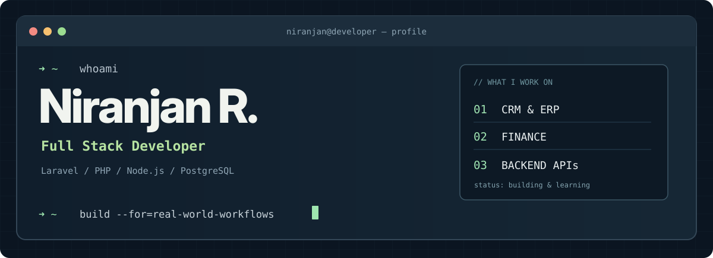
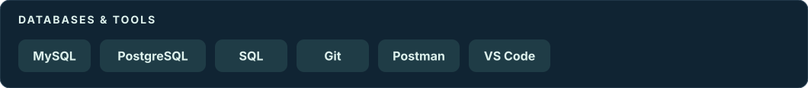

<!-- Developer Terminal | HTML compatible with GitHub README rendering -->

<code>full_stack_developer</code> &nbsp; <code>chennai_india</code> &nbsp; <code>laravel_backend</code>

  &nbsp;
  

<h2>About Me</h2>

I am a Full Stack Developer with a solid foundation in web application development and web design, and hands-on experience in backend development, databases, RESTful APIs, and enterprise applications. Currently working at VinGreen Technologies LLP, I have experience developing and maintaining CRM and ERP applications, implementing authentication and role-based access control, and building database-driven solutions using JavaScript, Node.js, PHP, Laravel, Python, MySQL, and PostgreSQL. I am actively improving my skills in full stack development while strengthening my knowledge of modern web technologies and learning through practical projects.

<h2>Technologies &amp; Tools</h2>

<h2>Experience Through Projects</h2>
<table>
  <tr>
    <td width="50%" valign="top">
      <h3>01 / Financial Workflow System</h3>
      
<strong>Journal Voucher &amp; Suspense Management</strong>

      
Worked on Journal Voucher processing, suspense ledger management, transaction matching, reconciliation, reporting, and audit logging.

      
<code>Maker–Checker</code> <code>Approvals</code> <code>Validation</code>

    </td>
    <td width="50%" valign="top">
      <h3>02 / Pharmaceutical CRM &amp; ERP</h3>
      
<strong>Sales &amp; Business Operations Tracker</strong>

      
Developed modules for leads, follow-ups, sample data requests, sales data, product inventory, and customer workflows.

      
<code>Laravel</code> <code>CRM / ERP</code> <code>RBAC</code>

    </td>
  </tr>
  <tr>
    <td colspan="2" valign="top">
      <h3>03 / Backend API Development</h3>
      
Developed Node.js backend APIs for a machinery product management application, including CRUD operations, server-side logic, input validation, and database integration.

      
<code>Node.js</code> <code>REST APIs</code> <code>CRUD</code>

    </td>
  </tr>
</table>

  
<strong>More on my financial application work</strong>

  
Worked with duplicate JV detection, Client UCC and amount matching, Bank OCR checking, KYC validation, account-status checks, multi-level approvals through email and the application UI, exception handling, reconciliation, and audit tracking.

<h2>Currently Learning</h2>

Backend architecture &nbsp;·&nbsp; Database design and optimization &nbsp;·&nbsp; Scalable business applications &nbsp;·&nbsp; API development &nbsp;·&nbsp; DevOps and deployment workflows

<strong>Want to connect?</strong> &nbsp; <a href="https://www.linkedin.com/in/niranjan-rg">Find me on LinkedIn ↗</a>

