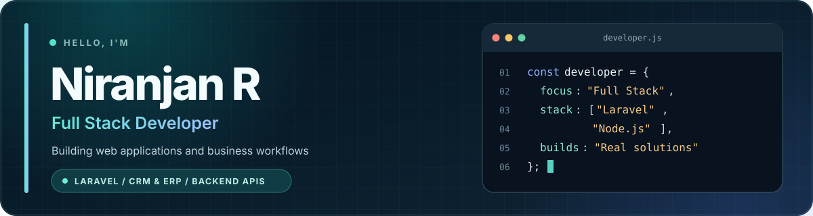

<!-- GitHub profile README · custom layout for Niranjan R -->

  

   
   

  
  
   
   
  📍 Chennai, Tamil Nadu, India &nbsp; · &nbsp; 💼 Full Stack Developer at VinGreen Technologies LLP

 

## 01 / About me

I'm a **Full Stack Developer** with a solid foundation in web application development and web design, along with hands-on experience in backend development, databases, RESTful APIs, and enterprise applications.

Currently working at **VinGreen Technologies LLP**, I have experience developing and maintaining CRM and ERP applications, implementing authentication and role-based access control, and building database-driven solutions using technologies such as **JavaScript, Node.js, PHP, Laravel, Python, MySQL, and PostgreSQL**.

I'm continuously improving my skills in full stack development, with a growing focus on backend development, database design, and modern web technologies. I enjoy learning new concepts, working on real-world projects, and improving my technical skills through practical experience.

 

## 02 / What I work on

<table>
  <tr>
    <td width="33%" valign="top">
      <h3>🏦 Financial workflows</h3>
      
Journal Voucher processing, suspense management, transaction matching, Maker–Checker controls, multi-level approvals, reconciliation, and audit logging.

    </td>
    <td width="33%" valign="top">
      <h3>🏢 CRM &amp; ERP</h3>
      
Customized business modules for lead management, follow-ups, sales operations, inventory, authentication, and role-based permissions.

    </td>
    <td width="34%" valign="top">
      <h3>⚙️ Backend APIs</h3>
      
Backend logic, REST APIs, CRUD operations, data validation, and database integration using Node.js and other backend technologies.

    </td>
  </tr>
</table>

 

## 03 / Tools & technologies

  

  

<code>REST APIs</code> &nbsp; <code>MVC</code> &nbsp; <code>SQL</code> &nbsp; <code>RBAC</code> &nbsp; <code>AJAX</code> &nbsp; <code>Agile / Scrum</code>

 

## 04 / Selected experience

  
<b>Journal Voucher &amp; Suspense Management System</b> · Financial workflows

   
  Worked on financial modules covering Journal Voucher processing, suspense ledger management, transaction validation, Maker–Checker controls, reconciliation, multi-level approval workflows, and audit tracking.

 

  
<b>Pharmaceutical Sales Tracker</b> · CRM / ERP

   
  Developed modules for leads, follow-ups, sample data requests, sales data, inventory, and customer workflows, with authentication and role-based access control.

 

  
<b>Machinery Product Management</b> · Node.js APIs

   
  Developed backend APIs for product management, including CRUD operations, server-side validation, business logic, and database integration.

 

## 05 / What I'm learning

  
  
  
  

 

  <h3>Let's connect</h3>
  
Interested in backend development, enterprise applications, and learning from other developers.

  
   
   
  Made with curiosity, practice, and a lot of debugging.

